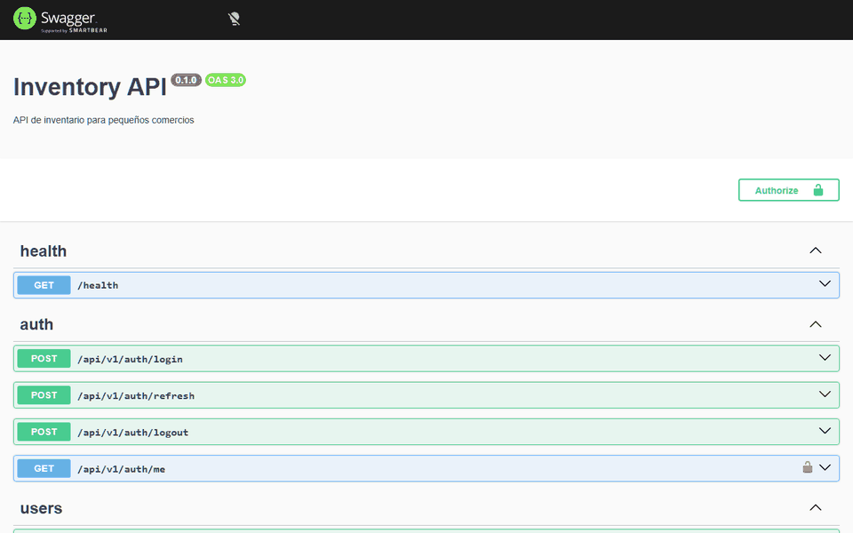
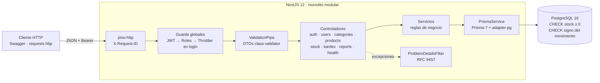
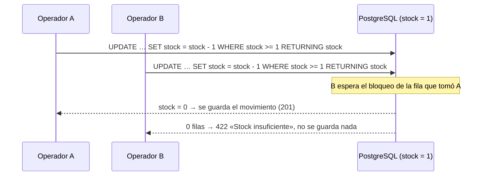
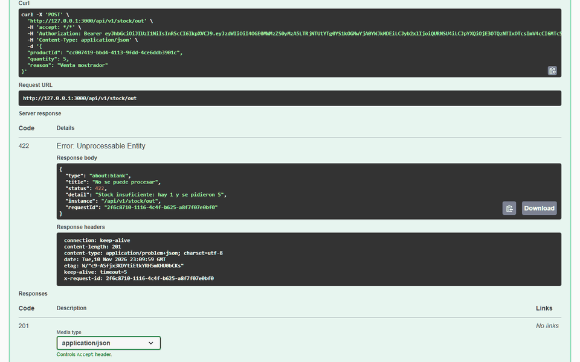
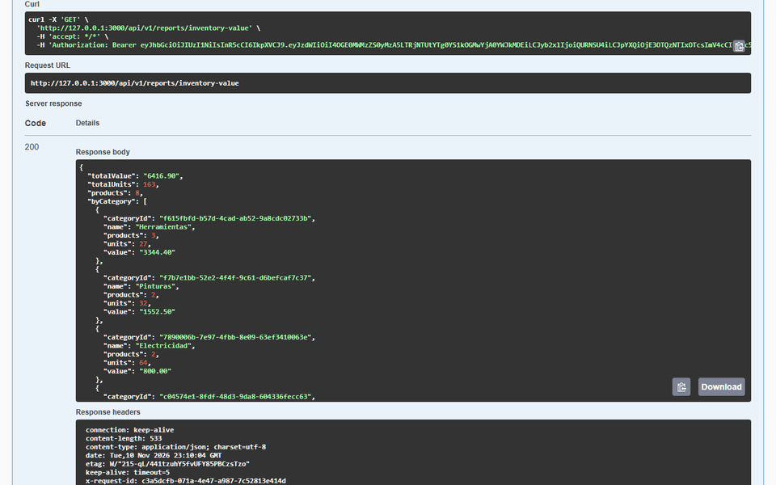

# Inventory API — NestJS, PostgreSQL y Docker

[](https://github.com/rolandocesar-prog-dev/inventory-api-nestjs/actions/workflows/ci.yml)

API REST de inventario para pequeños comercios (ferreterías, tiendas, farmacias): catálogo de
productos, entradas, salidas y ajustes de stock con **historial auditable (kardex)**, reportes,
autenticación con roles y la garantía de que **el stock nunca queda negativo, incluso con
operaciones simultáneas**.

**En vivo:** [documentación interactiva](https://inventory-api-c5yi.onrender.com/docs) ·
[estado](https://inventory-api-c5yi.onrender.com/health). Corre en planes gratuitos (Render +
Neon): la primera visita tras un rato sin uso puede tardar cerca de un minuto en despertar. Las
operaciones exigen una cuenta; para probarlas de punta a punta, usa Docker (abajo).



## Qué demuestra

- **Concurrencia resuelta en la base**: la salida de stock es una sola sentencia condicional
  (`UPDATE … WHERE stock >= q RETURNING stock`) dentro de una transacción, con `CHECK (stock >= 0)`
  como última defensa. Una prueba lanza 20 salidas simultáneas contra PostgreSQL real; otra, de
  control, muestra que el enfoque ingenuo de leer y luego escribir pierde ventas.
- **Autenticación seria**: JWT de 15 min, tokens de renovación opacos guardados como hash, con
  rotación y **detección de reutilización** (si un token robado se usa dos veces, se cierran todas
  las sesiones), guards globales de JWT y roles, límite de 5 intentos de login por minuto.
- **Dinero exacto**: precios y valorización en `numeric` de PostgreSQL y `Decimal`, nunca en
  coma flotante; la API los devuelve como texto con 2 decimales.
- **Errores y logs de producción**: errores en formato RFC 9457 (_problem details_), logs JSON
  con `X-Request-ID` y sin contraseñas ni tokens, `/health` que responde 503 si cae la base.
- **Calidad**: TypeScript estricto, 109 pruebas unitarias y 75 e2e contra PostgreSQL real en el
  CI, cobertura de servicios ≥ 80 % exigida (hoy 98,9 % de líneas), imagen Docker multi-etapa sin
  root.
- **Spec Driven Development**: requisitos EARS, diseño y plan por hitos en [`specs/`](./specs).

## Arquitectura





| Módulo    | Responsabilidad                                                             |
| --------- | --------------------------------------------------------------------------- |
| `auth`    | Login, renovación con rotación, logout, `GET /auth/me`, guards y throttler. |
| `users`   | Usuarios con argon2id; gestión solo para admin; semilla del admin inicial.  |
| `catalog` | Categorías y productos: SKU único, paginación, búsqueda, desactivación.     |
| `stock`   | Entradas, salidas, ajustes por conteo físico y kardex por rango de fechas.  |
| `reports` | Productos bajo el stock mínimo y valorización del inventario por categoría. |
| `health`  | Estado de la API y de la base con terminus (200 / 503).                     |
| `common`  | Paginación, filtro RFC 9457 y configuración de logs.                        |

## Resultados

| Qué se midió                                         | Resultado                                  |
| ---------------------------------------------------- | ------------------------------------------ |
| 20 salidas simultáneas de 1 unidad con stock 10      | 10 aceptadas, 10 rechazadas (422), stock 0 |
| Mismas salidas con «leer y luego escribir» (control) | Más de 10 «ventas» y stock > 0: se pierden |
| 15 salidas y 10 entradas mezcladas al mismo tiempo   | Stock ≥ 0 y igual a la suma de movimientos |
| Prueba de concurrencia repetida                      | 5 de 5 ejecuciones estables                |
| Pruebas                                              | 109 unitarias · 75 e2e (PostgreSQL real)   |
| Cobertura de servicios (umbral 80 % en el CI)        | 98,9 % líneas · 92,1 % ramas               |

| Swagger en `/docs`               | Salida sin stock: 422 (RFC 9457)                       | Valorización exacta                        |
| -------------------------------- | ------------------------------------------------------ | ------------------------------------------ |
|  |  |  |

## Endpoints

Rutas de negocio bajo `/api/v1`. Documentación interactiva en `/docs` (OpenAPI en `/docs-json`).

| Método y ruta                          | Rol     | Descripción                                                    |
| -------------------------------------- | ------- | -------------------------------------------------------------- |
| `POST /auth/login`                     | público | Token de acceso (15 min) y de renovación (7 días).             |
| `POST /auth/refresh` · `/auth/logout`  | público | Rotación del token de renovación · cierre de sesión.           |
| `GET /auth/me`                         | todos   | Usuario autenticado.                                           |
| `GET/POST /users` · `PATCH /users/:id` | admin   | Crear, listar, cambiar rol y desactivar usuarios.              |
| `GET /categories`                      | todos   | Categorías ordenadas por nombre.                               |
| `POST /categories` · `PATCH …/:id`     | admin   | Crear y renombrar (nombre único).                              |
| `GET /products`                        | todos   | `page`, `pageSize`, `search`, `categoryId`, `includeInactive`. |
| `POST/PATCH/DELETE /products…`         | admin   | Alta, edición y desactivación (nunca se borra).                |
| `POST /stock/in` · `/stock/out`        | todos   | Entrada y salida (422 si no alcanza el stock).                 |
| `POST /stock/adjustments`              | admin   | Ajuste por conteo físico, con motivo obligatorio.              |
| `GET /products/:id/movements`          | todos   | Kardex con `from`, `to` y paginación.                          |
| `GET /reports/low-stock`               | admin   | Productos con stock ≤ mínimo, los más urgentes primero.        |
| `GET /reports/inventory-value`         | admin   | Valor del inventario total y por categoría.                    |
| `GET /health`                          | público | 200 si la base responde; 503 si no.                            |

La colección [`requests.http`](./requests.http) recorre el flujo completo (REST Client de VS
Code o cliente HTTP de JetBrains).

Ejemplo de error (RFC 9457):

```json
{
  "type": "about:blank",
  "title": "No se puede procesar",
  "status": 422,
  "detail": "Stock insuficiente: hay 1 y se pidieron 5",
  "instance": "/api/v1/stock/out",
  "requestId": "2f6c8710-1116-4c4f-b625-a8f7f07e0bf0"
}
```

## Despliegue

| Pieza       | Dónde                                    | Cómo                                                                                 |
| ----------- | ---------------------------------------- | ------------------------------------------------------------------------------------ |
| API         | Render, servicio web gratuito con Docker | Blueprint [`render.yaml`](./render.yaml); despliega solo commits con el CI en verde. |
| PostgreSQL  | Neon, plan gratuito (no vence)           | Conexión directa con TLS; `DATABASE_URL` solo en Render y en GitHub.                 |
| Migraciones | GitHub Actions, workflow manual          | «Migrar producción»: `prisma migrate deploy` y semilla del admin.                    |

Detrás del proxy de Render, `TRUST_PROXY=true` hace que el límite del login cuente por la IP real
del cliente; comprobado en producción: el sexto intento responde 429 y falsificar
`X-Forwarded-For` no lo evita.

## Cómo ejecutarlo

Con Docker (base de datos, migraciones, admin inicial y API):

```bash
cp .env.example .env   # cambia contraseñas, JWT_SECRET y ADMIN_PASSWORD
docker compose up --build
# API: http://localhost:3000/docs  ·  PostgreSQL publicado en 127.0.0.1:5443
```

En local (Node.js 22 y la base del compose):

```bash
npm ci
npm run prisma:generate
docker compose up -d db
npm run prisma:deploy     # aplica las migraciones
npm run seed              # crea el admin de ADMIN_EMAIL / ADMIN_PASSWORD
npm run start:dev
```

> Para agregar dependencias usa npm 11 o superior (`npx npm@11 install …`); npm 10 tiene un
> fallo conocido con este árbol. `npm ci` funciona con ambas versiones.

## Calidad

```bash
npm run lint           # oxlint con información de tipos
npm run format:check   # Prettier
npm run typecheck      # tsc estricto
npm run test:cov       # unitarias + umbral de cobertura en servicios
npm run test:e2e       # e2e contra PostgreSQL (TEST_DATABASE_URL, base inventory_test)
```

El CI de GitHub Actions corre todo lo anterior con PostgreSQL 16 como servicio y además construye
la imagen Docker.

## Decisiones y aprendizajes

- **Una sentencia en vez de «leer y luego escribir»**. Con `SELECT` + `UPDATE` dos peticiones leen
  el mismo stock y ambas venden; la prueba de control lo reproduce. La sentencia condicional deja
  que PostgreSQL serialice las salidas con el bloqueo de fila, sin `SERIALIZABLE` ni reintentos.
  El ajuste, que necesita leer antes de escribir, usa `SELECT … FOR UPDATE`.
- **Cantidad con signo en los movimientos**. Entrada +, salida −, ajuste ±, con un `CHECK` que
  exige el signo según el tipo. Así la suma del kardex siempre es el stock y una prueba lo
  verifica.
- **Rol leído de la base en cada petición**. El JWT trae el rol, pero el guard carga el usuario:
  desactivarlo o quitarle el rol tiene efecto inmediato, sin esperar a que expire el token.
- **Tokens de renovación opacos y hasheados**. Un volcado de la base no permite iniciar sesión, y
  la rotación con detección de reutilización limita el daño de un token robado.
- **Prisma 7 con el adaptador `pg`**. El cliente se genera (no se versiona); las restricciones que
  Prisma no expresa (`CHECK`) van en SQL dentro de las migraciones.
- **Límite del login configurable**. Las pruebas e2e lo suben para no chocar con él y una prueba
  aparte verifica el 429 con el valor real.

## Cómo se desarrolla

El proyecto sigue **Spec Driven Development**:

- [`specs/requirements.md`](./specs/requirements.md): qué debe hacer, con criterios EARS.
- [`specs/design.md`](./specs/design.md): arquitectura, modelo de datos y decisiones.
- [`specs/tasks.md`](./specs/tasks.md): plan por hitos, con cada tarea en un commit.

## Licencia

[MIT](./LICENSE)
